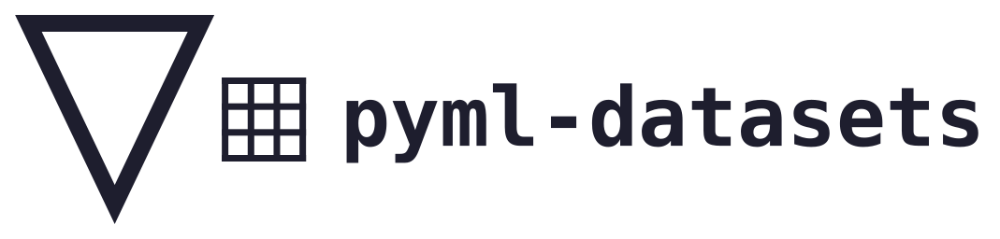

<p align="center">
  <picture>
    <source media="(prefers-color-scheme: dark)" srcset="assets/branding/logo-dark.svg">
    <source media="(prefers-color-scheme: light)" srcset="assets/branding/logo.svg">
    
  </picture>
</p>

[](https://github.com/sherzod-juraev/pyml-datasets/releases)
[](https://www.python.org/)
[](LICENSE)
[](#license)
[](https://github.com/sherzod-juraev/pyml-datasets/actions/workflows/tests.yml)
[](https://github.com/sherzod-juraev/pyml-datasets/actions/workflows/quality.yml)
[](https://github.com/sherzod-juraev/pyml-datasets/actions/workflows/docs.yml)
[](https://pyml-datasets.readthedocs.io/en/latest/)
[](https://docs.astral.sh/ruff/)
[](https://mypy.readthedocs.io/)
[](https://interrogate.readthedocs.io/)
[](https://nox.thea.codes/)

Classic tabular datasets for machine learning, stored as NumPy `.npz` files and loaded with a
single function call. No downloads at runtime, no network, no pandas: just NumPy arrays. Every
dataset carries its license, its source and its citation with it.

- **Documentation**: https://pyml-datasets.readthedocs.io
- **Source code**: https://github.com/sherzod-juraev/pyml-datasets
- **Main library**: [pyml](https://github.com/sherzod-juraev/pyml), a from-scratch machine
  learning library that uses these datasets in its examples

## What this is, and what it is not

This is a personal project. I am a student, and I made it for my own library, pyml, and to
learn how to package data properly. It is **not** a community project: I am not looking for
collaborators or contributors, and I may not answer issues or pull requests quickly, or at
all. You are welcome to use it, fork it and take it in your own direction; the code is MIT.
[CONTRIBUTING.md](CONTRIBUTING.md) explains how the project is built, mostly so that I
remember it myself.

I made a mistake that you should know about. Version 0.1.0 included three datasets
(Diabetes, Linnerud and California Housing) whose redistribution terms I could not confirm.
I did not check them carefully enough, and I did not do it on purpose. Since 0.2.0 they are
removed, and I now only bundle datasets that are explicitly under **CC0 1.0** or
**CC BY 4.0**, with the evidence kept in the repository (`legal/evidence/`). If you hold the
rights to something in this repository and want it changed or removed, see
[Takedown and corrections](#takedown-and-corrections).

## Quick example

Every loader returns a `Dataset` with the features `X` and the targets `y`:

```python
from pyml_datasets import load_wine

X, y = load_wine()
print(X.shape, y.shape)  # (178, 13) (178,)
```

The license and the citation are always available, without reading the data:

```python
from pyml_datasets import get_info, list_datasets

print(list_datasets("classification"))
info = get_info("iris")
print(info.license, info.citation)
```

Some datasets have missing values. They are stored as `NaN` in `X`, and `has_missing` tells
you before you start:

```python
from pyml_datasets import load_penguins

data = load_penguins()
print(data.has_missing, data.categorical_features)
```

Together with [pyml](https://github.com/sherzod-juraev/pyml):

```python
from pyml.model_selection import train_test_split
from pyml.neighbors import KNNClassifier
from pyml_datasets import load_iris

X, y = load_iris()
X_train, X_test, y_train, y_test = train_test_split(X, y, test_size=0.2, random_state=42)

model = KNNClassifier(n_neighbors=5)
model.fit(X_train, y_train)
print(model.score(X_test, y_test))  # accuracy on the test set
```

> [!NOTE]
> Importing `pyml_datasets` does not read any data. A dataset file is read from disk only when
> its `load_*` function is called, so the import stays fast and you only load the datasets you
> use.

## Installation

pyml-datasets is not published on PyPI. It requires Python 3.12 or newer (NumPy is the only
dependency) and is installed directly from GitHub:

```bash
pip install git+https://github.com/sherzod-juraev/pyml-datasets.git
```

To install a fixed release, add its tag after `@`, replacing `vX.Y.Z` with a tag from the
[Releases](https://github.com/sherzod-juraev/pyml-datasets/releases) page:

```bash
pip install git+https://github.com/sherzod-juraev/pyml-datasets.git@vX.Y.Z
```

## What's inside

This table is generated from the data files. See [NOTICE.md](NOTICE.md) for the creators,
the sources, the citations and the changes made to each dataset.

<!-- datasets:start -->
| Function | Task | Samples × features | Missing values | License |
|:---------|:-----|:------------------:|:--------------:|:-------:|
| `load_breast_cancer` | Classification | 569 × 30 | no | CC BY 4.0 |
| `load_digits` | Classification | 1797 × 64 | no | CC BY 4.0 |
| `load_iris` | Classification | 150 × 4 | no | CC BY 4.0 |
| `load_penguins` | Classification | 344 × 7 | yes | CC0 1.0 |
| `load_wine` | Classification | 178 × 13 | no | CC BY 4.0 |
| `load_wine_quality` | Regression | 6497 × 11 | no | CC BY 4.0 |
<!-- datasets:end -->

## License

The code is released under the [MIT license](LICENSE). The datasets were created by other
people and keep the license of their source, either
[CC0 1.0](LICENSES/CC0-1.0.txt) or [CC BY 4.0](LICENSES/CC-BY-4.0.txt), as shown in the
table. CC BY 4.0 requires attribution: if you use a dataset, cite it as given in
[NOTICE.md](NOTICE.md) or in `get_info(name).citation`. The wheel ships `NOTICE.md` and the
license texts.

Each license was checked at the source of the dataset on the date written in
`legal/evidence/<name>.md`. I am not a lawyer, and this is not legal advice. Licenses can
also change at the source, so please check yourself if it matters for your use.

## Takedown and corrections

If you are the creator or the rights holder of a dataset here and the license, the
attribution or the changes listed for it are wrong, or you do not want it distributed, write
to juraevsherzod9943@gmail.com. I will fix or remove it. Removing a dataset from the current
version is quick; removing it from the git history of the repository is something I can do
too, and I will if you ask.

## Documentation

- [Datasets](https://pyml-datasets.readthedocs.io/en/latest/datasets/index.html)
- [License](https://pyml-datasets.readthedocs.io/en/latest/license.html)
- [Changelog](https://pyml-datasets.readthedocs.io/en/latest/changelog.html)
- [pyml documentation](https://pyml-edu.readthedocs.io)
